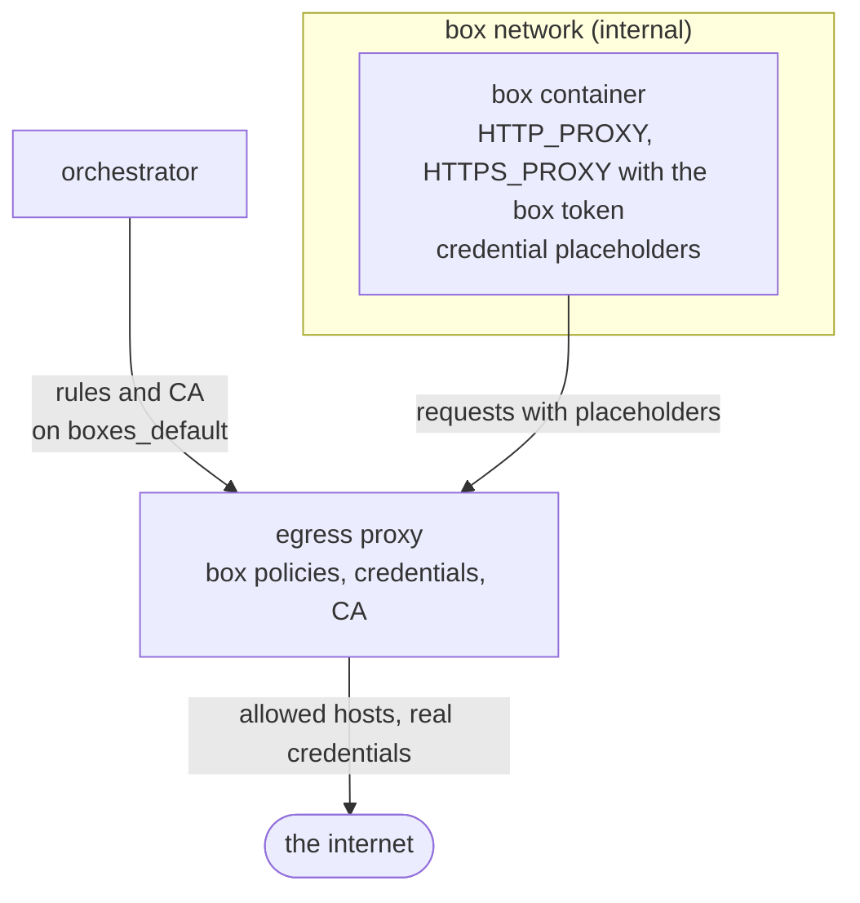
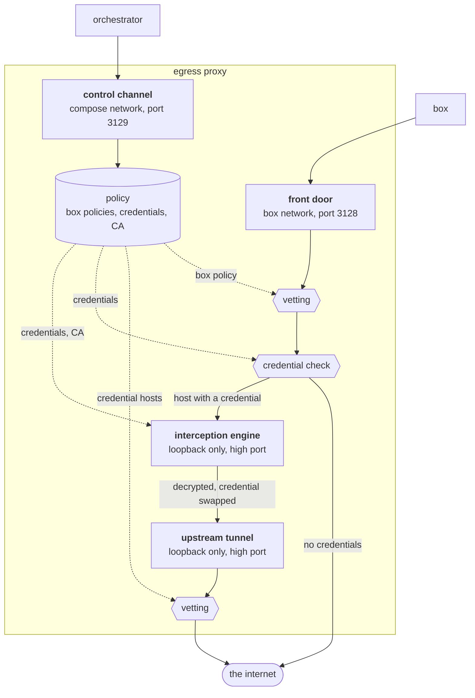

# Egress proxy

Boxes creates a private Docker network for each [box](boxes.md), and creates it as an internal network. Such a network
has no route to the outside. The egress proxy is attached to it, and is the only way out.

The proxy does two things. It controls which hosts the tools in a box can connect to, with the
[egress profile](egress-profiles.md) of the box. It also replaces the credential placeholders in the requests that go
to those hosts. A real credential thus never enters a box container.

The proxy keeps its rules in memory. It has no configuration file and no database. The orchestrator sends the rules to
the proxy at start, and again after each change to a credential, an API key, an MCP server, a profile or a box. Only
the Compose network `boxes_default` can connect to this control channel. The orchestrator and the proxy share that
network, and the box networks have no route to it.

## Network access

The orchestrator sets `HTTP_PROXY` and `HTTPS_PROXY` in the environment of each box container. Tools that use these
variables connect through the proxy. The [egress profile](egress-profiles.md) of the box decides which hosts and ports
the proxy allows. All other connections fail, because the box network has no other route. An agent thus cannot use SSH,
and cannot connect to a database on a remote host. The proxy always refuses a private address, also when a public host
name has a private address. The proxy closes a connection that carries no traffic for 120 seconds.

## Credentials

The orchestrator puts only a placeholder for each credential into the environment of a box container. The real
credentials stay in the credential store and in the memory of the proxy. Thus an agent cannot leak a real credential by
accident, for example in a commit or in a log.

When a user saves a [credential](credentials.md) on the settings page, the proxy intercepts the TLS connections to the
hosts that accept this credential. It decrypts each request, examines the credential header, and sends the request on:

- If the header has the placeholder, the proxy rewrites it with the real credential.
- If the header has a different value, or the request has no credential header, the proxy sends it unchanged.

For the [other API keys](credentials.md#other-api-keys), the proxy applies these rules to every header of the request,
not only to the credential header.

The proxy does not intercept any other host. It only sends that traffic through, and does not read it.

Each credential is valid for a fixed set of hosts:

| Credential | Valid hosts |
| --- | --- |
| Claude | `api.anthropic.com` |
| OpenAI | `api.openai.com` |
| GitHub | `github.com`, `api.github.com`, `*.githubusercontent.com` |
| GitLab | `gitlab.com`, or the host in `GITLAB_HOST` |
| Dev Tunnels | `*.rel.tunnels.api.visualstudio.com` |
| Other API keys | the hosts set for each key |
| Secrets of [MCP servers](agent-sets.md#mcp-servers) | the host and the port of the MCP server |

## The deployment certificate authority

The orchestrator creates a certificate authority once and stores it in the [data volume](storage.md). It sends the
certificate and the key to the proxy with the rules. The proxy then creates a certificate for each host that it
intercepts.

The orchestrator also writes the certificate to `~/.boxes/proxy-ca.crt` in each box, and the
[box setup](boxes.md#the-setup) writes it together with the system certificates to `~/.boxes/ca-bundle.crt`. The
environment variables `NODE_EXTRA_CA_CERTS`, `SSL_CERT_FILE`, `GIT_SSL_CAINFO` and `CURL_CA_BUNDLE` contain the path
of that bundle. A tool that uses none of these variables fails on the intercepted hosts, and works on all other hosts.

## Settings

[Environment variables](environment.md) describes the ports and the names that the orchestrator and the proxy use.
[Docker Compose setup](compose.md) describes the network layout.

## Technical internals

The proxy (`proxy/src/`) runs four listeners:

1. control channel: the orchestrator connects to it on the Compose network and sends the rules and the CA.
2. front door: the tools in a box connect to it on the box network and send their requests.
3. interception engine: the front door hands connections to it for the hosts that have a credential. It decrypts the
   request, examines the credential header, and sends the request on.
4. upstream tunnel: the only way out of the engine. The engine connects to it on the loopback.

### Box identity

The orchestrator gives each box a random token, and puts the box id and the token into the proxy URL of the box as the
user and the password, for example `http://<box id>:<token>@proxy:3128`. A client sends them in the
`Proxy-Authorization` header with the Basic scheme. The front door finds the box from the token, and the box id in the
header must match. A request without a valid header gets `407 Proxy Authentication Required` with
`Proxy-Authenticate: Basic realm="boxes"`, and the proxy counts it under the category `proxy-auth`. Some clients, for
example git and Chromium, send the header only after a 407. `box-image/setup.d/20-browser` writes the user and the
password into their own fields of the browser config, because Chromium ignores them in the URL.

The front door removes `Proxy-Authorization` from a plain HTTP request, and the handoff to the engine replays only the
CONNECT line and the `Host` header. The token thus never leaves the proxy.

### Vetting

Vetting is one function, `vetTarget` in `forward.ts`. Each forwarder calls it before it connects, so no socket leaves
the proxy unvetted.

A tunneled host passes vetting one time. The front door vets the destination, and then opens the connection itself.

An intercepted host passes vetting two times, because that path opens two connections. The front door does not connect
to the host; it connects to the engine on the loopback, and the address that it vetted is of no more use. The engine
then makes its own request, and that request leaves through the upstream tunnel. The tunnel vets before it connects, as
every forwarder does.

The front door vets a target against the policy of the box. The connections of the engine have no box identity, so the
upstream tunnel vets them against a closed policy with the hosts of all credentials. The engine connects only to
credential hosts, and the front door has already vetted the target against the policy of the box.

The front door and the upstream tunnel are the same server code. Only the front door hands connections to the engine.
The tunnel never intercepts, so the connections of the engine cannot loop back into it.

The front door (`forward.ts`) handles plain HTTP with an absolute URI, and CONNECT. It vets a target in a fixed order:
the host and the port, then the address. The host check comes before the DNS lookup, so the proxy never resolves a
denied name. Every resolved address must pass. `shared/cidr.ts` holds the blocked ranges, with the IPv6 forms that
embed an IPv4 address, and input that it cannot parse fails closed.

A forwarder connects to the one address that vetting chose, and does not resolve the name a second time. This closes DNS
rebinding for that connection. On the intercepted path the upstream tunnel gives this protection, because the front door
drops its address when it hands the connection to the engine.

The front door refuses a credential host in the clear, which is plain HTTP and a CONNECT to port 80. Such a request
has no TLS for the engine to terminate, so the proxy would send either the real credential or the placeholder as
plaintext. On a CONNECT to another port, the front door hands the connection to the engine when a host of the credential
names that port. The engine connects upstream on the same port, so the upstream tunnel checks the port again.

The front door forwards nothing before the first policy push arrives.

A refusal by the profile of the box has the category `allowlist` or `port`. The front door answers it with the status
`403 Not allowed by the egress profile` and a body that names the target, and writes the box id, the target and the
category to the log. `RefusedTargets` in `refused.ts` holds the
[refused hosts](egress-profiles.md#refused-hosts), and drops the list of a box when a new policy does not have the box.
The orchestrator reads the list on the control channel with `GET /denials?box=<id>`.

### Policy

`policy.ts` implements the credential decision as pure functions, with no I/O and no state. `shared/hosts.ts` holds the
grammar of the host patterns, so the orchestrator checks a host with the rule of the proxy.
The intercepted hosts and their credential headers are fixed in `orchestrator/src/config.ts`: they are facts about the
services, and no setting changes them. The exceptions are the GitLab host, which `GITLAB_HOST` names, and the hosts of
the other API keys, which a user sets on the settings page.

The OpenAI entry is the special case. Codex authenticates with an API key to `api.openai.com` or with a subscription
login to `chatgpt.com`, and the two endpoints reject each other's credential. The proxy intercepts only
`api.openai.com`, because only there an API key is valid. `chatgpt.com` is allowed but never intercepted, so the
subscription login goes through unchanged. This lets an API key and a subscription login coexist in one box.

### Interception

The interception engine (`inject.ts`, built on the mockttp library) implements the credential decision described above.
It reads only the headers the policy names for a host, and it treats nothing else as a credential. The swap works on the
header value: the engine replaces the placeholder string wherever it appears, so one mechanism covers the `Bearer` and
`token` schemes, a bare value, and the base64 `user:password` pair of HTTP Basic that git's credential helper sends.

The engine listens on all interfaces, so it refuses every peer that is not on the loopback. The front door alone can
reach it, and thus nothing enters the engine that the front door did not vet. The destination also stays what the front
door saw: the engine takes it from the CONNECT that the front door replayed, not from the `Host` header of the decrypted
request.

A protocol upgrade is forwarded with its headers unchanged, so the engine refuses an upgrade that would need a swap.
This is why the box image sets `supports_websockets = false` for Codex: the harness uses HTTPS directly instead of
retrying a refused upgrade.

The proxy reports to the orchestrator when an MCP server refuses an OAuth token. The orchestrator then refreshes the
token or marks the login as failing. An answer 401, or an answer 403 with a Bearer challenge, is a refusal, and the
proxy keeps the scopes that the challenge asks for. The proxy cannot call the orchestrator, so it returns the refusals
in the answer to the next policy push. The engine reads the status when the answer starts, so an event stream reaches
the client without delay.

The engine resolves no name of its own. It sends every request to the upstream tunnel, and the tunnel vets the
destination and opens the socket.

### Control channel

The control channel (`control.ts`) binds to the container's own address on the network that carries the default route.
Box networks install no default route, so this address is on the Compose network — this is how the restriction described
above is enforced. The proxy itself is not configured with a token: the first push claims the channel with the bearer it
presents, and the proxy refuses every later call that presents a different one.

The orchestrator side (`orchestrator/src/egress.ts`) generates the CA and that token once, and stores them in the
database. A placeholder is generated when a credential is stored, and is kept with it. A restarted proxy has lost the
policy, so the reconciler pushes it again every minute.

`composePolicy` builds one policy for each box that is not deleted, with its id, its token, the mode of its profile and
its hosts. The hosts are those of the profile, the credentials and the API keys of the owner, and the MCP servers of the
box. The policy holds the credentials, the API keys and the secrets of the MCP servers of every [user](users.md), so one
host can have more than one credential. The proxy selects the credential whose placeholder is in the request. In the
policy, the id of a credential has its owner as a prefix, for example `alice/claude`, because the ids must be unique. A
credential of the empty user has no prefix. The credential of a secret of an MCP server names only the header of the
secret, and its id is `<owner>/mcp/<set>/<server>/<header>`.
